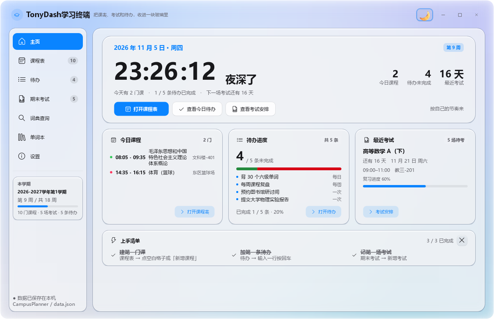
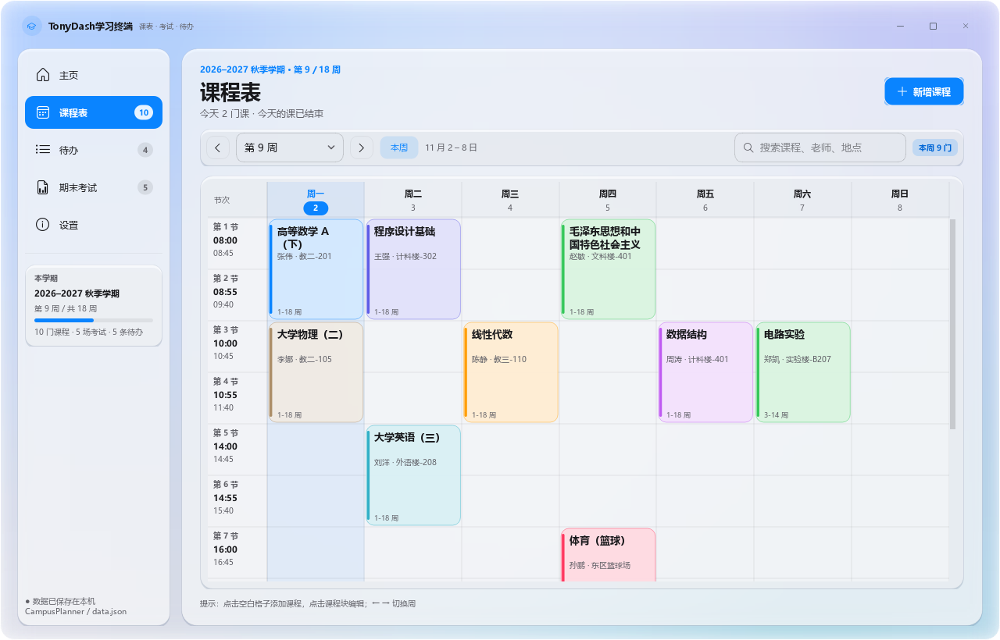

# TonyDash学习终端

面向本科生的桌面版学习面板：一块会打招呼的时间屏幕、一张可自由编辑的课表、一套真正能用的期末考试信息系统，再加一份每天都能勾掉的待办清单。
浅色毛玻璃（亚克力）界面，iOS 蓝强调色，纯本地存储，不联网、不依赖浏览器。

当前版本：**Beta 1.4**（2026-11-04）





## 功能

### 启动动画
- 每次启动展示一段深色科技感动画：渐变背景、流动光团、细网格与向上飘的学习标签。
- 依次浮现软件 LOGO、名称、版本号与开发者头像，配一句激励学习的文案，底部进度条收束后进入主界面。
- 动画全程由 Qt 绘制，不依赖任何网络素材，离线可用。

### 时间屏幕主页
- 大号时钟每秒跳动，按早上 / 中午 / 下午 / 晚上 / 深夜给出问候。
- 今日课程、待办未完成、最近考试三项摘要，以及本周 7 天的课程密度。
- 三个快捷入口直接跳到课程表、待办与考试页。

### 课表管理
- 7 天 × 可配置节次的自绘网格，点击空白格即可新建课程，点击课程块即可编辑。
- 星期表头固定在网格上方：纵向滚动到第 12 节也不会丢掉列名，横向滚动时同步偏移。
- 课程字段：名称、老师、地点、星期、起止节次、周次（每周 / 单周 / 双周 / 自定义文本，如 `1-8, 10-16`）、8 种颜色、备注。
- 周次换算：选择学期开学周、总周数后，自动显示每周对应日期、今天高亮。
- 冲突检测：同一时段重叠的课程会在课程块上标红点，并可一键查看冲突明细。
- 搜索课程 / 老师 / 地点时，不匹配的课程自动淡出；可隐藏周末列。

### 待办清单
- 三种待办：每日、每周、一次性；每日跨天自动重置，每周周一重置，已完成的一次性待办次日自动归档。
- 每张待办卡都有方形勾选框：完成变绿，标题自动加删除线。
- 一次性待办可设截止日期，逾期显示红色提醒，今天到期显示琥珀色。
- 循环待办自动记录每次完成日期，点日历按钮打开月历，绿色高亮打卡日。
- 右键菜单：查看完成记录、标记完成 / 未完成、删除此待办。
- 顶部四枚同字号统计（全部 / 已完成 / 未完成 / 完成度）；下方是一条铺满内容区的双色进度条：已完成绿色、未完成红色，切换时带缓动动画。
- 每完成一项，勾选框会弹跳，并在卡片附近撒出一小把彩纸。
- 快速添加：输入内容、按回车即可；也可切换类型后再添加。日期框任意位置点击都会弹出浅色日历。

### 期末考试信息系统
- 下一场考试倒计时（天 / 时 / 分 / 秒），待考科目数、待考学分、最近一场距离天数、平均复习进度四项统计。
- 考试字段完全可自定义：科目、类型（闭卷 / 开卷 / 机考 / 大作业 / 口试 / 论文，可自己输入新类型）、学分、日期、开始时间、时长、地点、座位、复习进度、备注。
- 自定义字段：每场考试可加“允许文具”“考场规则”等任意键值行，列表里以标签展示。
- 冲突提醒：两场考试时间重叠、或考试当天与课表课程时间冲突时，卡片上直接标出。
- 按日期分组、按时间 / 学分 / 科目排序，按待考 / 已结束筛选。
- 一键导出 `.ics` 日历，可导入手机或系统日历。

### 设置与数据
- 学期名称、开学第一周周一、总周数、是否显示周末。全新安装默认「2026-2027学年第1学期」、开学第一周周一为 2026-09-14；改完开学日期后左栏学期进度条会立刻重算。
- 作息时间表：逐节编辑上下课时间，每节用「小时 / 分钟」两个下拉框，点击即可直接输入，滚轮不会误改；可增删节次、按 45 分钟一键重排、采用浙江工商大学作息（第一节 8:05 起共 12 节）。
- 深浅两套主题：标题栏一键切换，设置页也有浅色 / 深色分段控件；切换时当前画面整体淡出再淡入，背景与文字一起过渡。
- 毛玻璃强度滑杆（20–100），拖动时背景连续变化；可关闭动画。
- 鸣谢名单：按学校拼音排序，展示参与测试与反馈的同学，校徽可自行替换为官方 Logo。
- 数据自动保存到 `%APPDATA%\CampusPlanner\data.json`，支持 JSON 备份 / 恢复、清空全部。
- 界面图形（图标、背景、玻璃卡片）由 Qt 绘制；关于页的头像与 GitHub Logo 为内置本地资源，不联网。

### 关于与更新日志
- 关于界面参考「拾光 ShiGuang」的信息结构：应用图标、名称、slogan、版本、发布日期、开发者。
- GitHub 卡片包含作者头像与 GitHub Logo，点击直达 <https://github.com/xiaoyan2007>；打开失败时自动回退到系统浏览器。
- 关于界面展示最近更新，并提供「查看完整更新日志」按钮，在独立窗口打开全部记录，当前版本在最上方；`update log/` 文件夹同步保存逐版本 txt。

## 运行

### 安装包（推荐）
双击 `release\TonyDash学习终端-Beta1.2-Setup.exe`，按向导安装。

- 安装包内置 Python、Qt 与 VC++ 运行库，目标电脑**不需要安装 Python 或任何开发环境**。
- 安装向导包含中文用户协议；可自行选择安装目录。
- 默认创建桌面快捷方式，并默认勾选「开机自动启动」；两项都可以在组件页取消。
- 卸载时删除程序与快捷方式，保留 `%APPDATA%\CampusPlanner` 中的课程/考试/待办数据，避免误删。
- 静默安装：`TonyDash学习终端-Beta1.2-Setup.exe /S /D=D:\你的路径`（`/D` 必须是最后一个参数）。

### 直接运行打包版
双击 `release\TonyDash学习终端-Beta1.2\TonyDash学习终端-Beta1.2.exe`。

> 请保留整个 `release\TonyDash学习终端-Beta1.2` 文件夹（exe 旁边的 `_internal` 是运行时依赖），可以整体复制到任意位置，但不要只拷走 exe。
> 首次启动是空白状态，不预置任何课程、考试或待办；从主页或课程表开始添加即可。

### 旧版 Beta 1.0
`release\TonyDash学习终端-Beta1.0\TonyDash学习终端-Beta1.0.exe` 是整合待办之前的原始最终版（程序内部仍显示「课表 · 期末」），仅用于对照/回溯。

### 从源码运行
```bat
py -m pip install PySide6
py main.py
```
> Windows 上请使用 `py` 启动器；本项目开发环境为 Python 3.14 + PySide6 6.12。

## 快捷键

| 快捷键 | 作用 |
| --- | --- |
| `Ctrl+1 / 2 / 3 / 4 / 5` | 切换到主页 / 课程表 / 待办 / 期末考试 / 设置 |
| `Ctrl+N` | 新建课程、考试，或在待办页聚焦输入框 |
| `Ctrl+,` | 打开设置 |
| `← / →` | 在课程表页切换上一周 / 下一周 |
| `Esc` | 关闭弹窗 |

## 数据位置

```
%APPDATA%\CampusPlanner\data.json
```
- 数据格式 v2，新增 `tasks` 字段；旧版 v1 备份导入时会自动补全为空待办列表。
- 写入采用临时文件 + 原子替换，异常退出不容易写坏。
- 文件损坏时会自动备份为 `data.json.bad` 并回落到空白数据。
- 换电脑时在设置页“导出备份 JSON”，到新电脑“从 JSON 导入”即可。

## 发布目录

```
release/
  TonyDash学习终端-Beta1.2-Setup.exe  Beta 1.2 安装包
  TonyDash学习终端-Beta1.2/    Beta 1.2（exe + _internal）
  TonyDash学习终端-Beta1.1/    上一版（exe + _internal）
  TonyDash学习终端-Beta1.0/    原始 Beta 1.0 最终版
```

> 当前源码已到 **Beta 1.4**；按本版本安排，Beta 1.4 的 exe 与安装包尚未打包，打包命令见下文。

## 备份机制

每次改动代码前，运行：

```bat
py backup.py 本次改动说明
```

脚本会在 `backup\YYYYMMDD-HHMMSS-本次改动说明\` 下保存一份完整快照：
- `code/`：`campus_planner/`、`tests/`、`assets/`、`update log/`、`main.py`、`README.md`、`backup.py`、`.spec`
- `app/`：整个 `dist/` 打包产物
- `MANIFEST.txt`：备份时间、版本号、文件数与总大小

已有的历史备份（initial / pre-todo-core / pre-todo-ui / pre-about-polish / pre-todo-tests / pre-beta1.2）都在 `backup/` 下。

## 项目结构

```
main.py                     程序入口（含 --selftest 离屏自检）
backup.py                   改动前快照脚本
campus_planner/
  core.py                   数据模型、待办跨天重置、周次、冲突、存储、ICS 导出
  changelog.py              Beta 1.0–1.4 更新日志数据与 HTML / 纯文本生成
  theme.py                  配色、字体、图标、背景与玻璃绘制、全局 QSS、主题令牌
  widgets.py                玻璃卡片、按钮、开关、分段控件、时间选择器、弹窗等通用组件
  dialogs.py                课程编辑 / 考试编辑弹窗
  about_dialogs.py          关于、完整更新日志、待办完成历史弹窗
  credits.py                鸣谢名单（学校徽标与同学列表）
  splash.py                 启动动画（LOGO、头像、版本号与激励文案）
  main.py                   无边框主窗口、五页导航、数据流与快捷键
  pages/
    common.py               页头等公共部件
    home.py                 时间屏幕主页（时钟、问候、摘要与本周概览）
    schedule.py             课程表页（自绘网格 + 固定表头）
    todo.py                 待办页（任务卡、快速添加、筛选、完成历史）
    exams.py                期末考试页（倒计时 / 统计 / 卡片列表）
    settings.py             设置页
tests/
  test_core.py              31 项核心逻辑单测
  test_tasks.py             6 项待办 / 更新日志单测
  test_gui.py               30 项离屏 GUI 冒烟测试
  preview_app.py            渲染页面截图
  preview_style.py          组件样式样张
update log/                 逐版本更新日志 txt
assets/                     应用图标、GitHub 头像 / Logo 与界面截图
backup/                     改动前快照
```

## 开发与测试

```bat
py -m unittest discover -s tests -v
```
当前共 **67 项测试**（31 核心 + 6 待办 / 日志 + 30 GUI），全部离屏运行，无需真实显示器。另有 `tests/_verify_b14.py` 逐条核对 Beta 1.4 的 9 项需求。

```bat
py tests/preview_app.py     :: 输出 tests/_shots/page_*.png
py main.py --selftest       :: 离屏渲染一帧，输出 selftest.png
```

打包（PyInstaller）：

```bat
py -m PyInstaller --noconfirm --clean --onedir --windowed ^
  --name "TonyDash学习终端-<版本后缀>" --icon assets/app.ico ^
  --add-data "assets;assets" main.py
```

制作安装包（NSIS 3）：

```bat
cd installer
makensis TonyDash.nsi
```
输出为 `release\TonyDash学习终端-Beta1.2-Setup.exe`。

## 设计说明

- 视觉参考 `ShiGuangToDo V0.2.exe` 的白玻璃质感：极浅蓝白渐变背景、柔光色团、半透明白色卡片与 1px 高光描边、18px 圆角、iOS 蓝 `#0A84FF` 强调色。
- 深浅两套主题令牌化：背景渐变、玻璃卡片填充 / 阴影 / 高光、文字与控件配色全部随模式重绘；切换时用当前画面截图做交叉淡出。
- 启动动画参考 Photoshop CC2026 的深色科技感：渐变底、流动光团、网格、粒子与向上飘的学习标签，LOGO 带光晕与旋转虚线环。
- 待办交互与更新日志结构参考「拾光 ShiGuang」V0.2（作者 yyx），在关于界面保留了致敬说明。
- 字体使用系统自带的 Microsoft YaHei UI 与 Segoe Fluent Icons；月亮 / 太阳 / 心形等图标用 QPainter 矢量绘制，避免部分系统缺少码位而退化成字母，全部离线可用。
